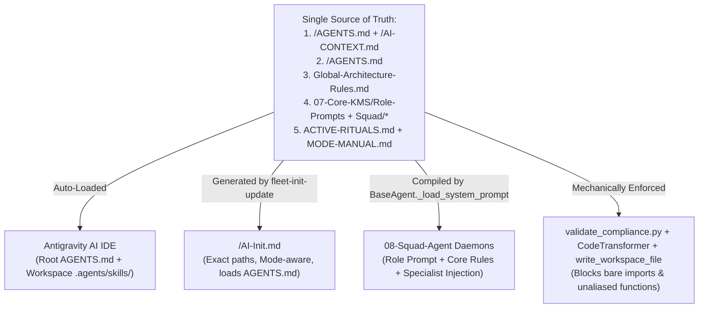

# 🏛️ Ecosystem AI Governance Synthesis & Unification Blueprint

## 1. Executive Diagnosis: Unifying AI IDE & Squad-Agent

When working in **Antigravity AI IDE**, root `AGENTS.md` and service-level `<repo>/AGENTS.md` are automatically injected into the system context. When starting a session via `<repo>/AI-Init.md` or running the autonomous `08-Squad-Agent` daemon, the AI must receive the **exact same core invariants, active rituals, and language specialist standards**.

---

## 2. Core Pillars Applied Across the Ecosystem

1. **Invariant `#7` in Root `AGENTS.md` & `AI-CONTEXT.md` (Language-Specific Import, Header & Visual Formatting Invariants)**:
   - **Python ("Bastien" Granular Functional Import & camelCase Aliasing Rule)**:
     - Every `.py` file starts with `#!/usr/bin/env python`, `# coding:utf-8`, Triple-Block docstring (`ESSENTIAL PROCESS`, `DATA FLOW`, `KEY PARAMETERS`), and 1 blank line.
     - **Zero Whole-Module Imports**: Never write `import os`, `import sys`, `import re`, `import json`, `import time`, `import subprocess`, etc. outside the entrypoint `bootstrap_microservice` block.
     - **Granular & camelCase Aliased (`[module][SymbolName]`)**: Import only required symbols from stdlib/external packages and alias them in camelCase (e.g. `from os.path import join as osPathJoin, exists as osPathExists`, `from json import dumps as jsonDumps, loads as jsonLoads`, `from datetime import datetime as dtDateTime`, `from typing import Any as typeAny, Dict as typeDict, Optional as typeOptional`). Combine multiple symbols from the same module onto a single line.
     - **Do NOT Alias Local/Internal Imports**: Never alias internal project imports (`from src.interfaces import SquadEventBus`, `from .storage import Storage`).
     - **95-Dash Dividers & `.format(self.Name)` Logging**: Separate methods with 95 dashes (`# -----------------------------------------------------------------------------------------------`) and prefix logs via `self.logger.info("{0} : ...".format(self.Name))`.
   - **Go**: Triple-Block Header (`/* ESSENTIAL PROCESS ... */`), 4-Block Import Structure (Stdlib, Local, Ecosystem aliased, External), and 77-dash dividers.
   - **Rust**: Triple-Block Header (`//! ESSENTIAL PROCESS ...`), 95-dash dividers.

2. **Mechanical Enforcement & Auto-Transformation (`validate_compliance.py` & `improved_transformer.py`)**:
   - `ComplianceAuditor.audit_python_imports()` AST-audits Python files for whole-module imports (`PYTHON_WHOLE_MODULE_IMPORT`), unaliased external/stdlib imports (`PYTHON_UNALIASED_IMPORT`), aliased local imports (`PYTHON_LOCAL_IMPORT_ALIASED`), and unmerged same-module imports (`PYTHON_DUPLICATE_FROM_MODULE`).
   - `CodeTransformer._ensure_granular_imports()` generalizes AST rewriting for any stdlib/external module using `_make_camel_alias(module_name, symbol_name)`.

3. **Squad-Agent Runtime Context & Tool Hardening (`base_agent.py`, `developer.py`, `convert_agents.py`)**:
   - `BaseAgent._load_system_prompt()` compiles workspace root `AGENTS.md`, `ACTIVE-RITUALS.md`, the role prompt, and (for `DeveloperAgent`) the `03-Developer/Squad/*.md` language specialist rules.
   - `BaseAgent.execute_tool("write_workspace_file")` runs `ComplianceAuditor` (with `strict_imports=True` on `.py` files) and appends any compliance violations directly to the tool output so agents self-correct immediately.
   - `convert_agents.py` syncs `.agents/skills` to both `obsidian-brain/.agents/skills` and workspace root `.agents/skills`.

4. **Standardized Fleet `AI-Init.md` (`fleet_init_update.py`)**:
   - Propagates accurate workspace-relative paths (`obsidian-brain/08-Squad-Agent/main.py`), mandates reading root `AGENTS.md`, `AI-CONTEXT.md`, and local `AGENTS.md`, and respects `MODE-MANUAL.md` and `Squad/*.md` specialists across all 14 repositories.

