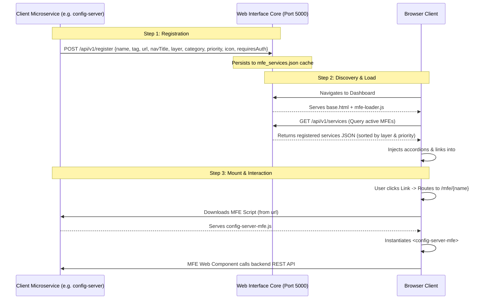
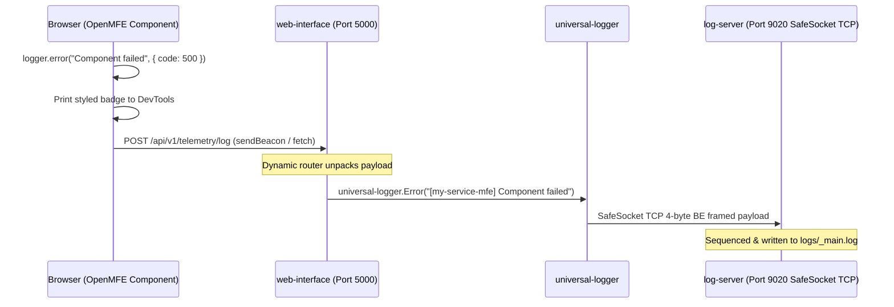

# 🌐 OpenMFE Microfrontend Integration Protocol

This protocol defines how to build, register, and test pluggable, decentralized user interfaces (Microfrontends) in the Bastien Ecosystem using the **OpenMFE standard** and HTML5 Web Components.

---

## 1. High-Level Architecture

The `web-interface` server includes an integrated **MFE Registry** and a client-side **MFE Loader** to mount sub-frontends dynamically into the right `#Sidenav` drawer without rebuilding the core server.



---

## 2. Integration Specifications

### 2.1 The Registry Endpoints
The registry is built directly into the `web-interface` server on **Port 5000** (or dynamically resolved via `appConfig.GetListenAddr("web_interface")`).
- **POST `/api/v1/register`**: Used by microservices at boot time to publish their frontend configuration.
  ```json
  {
    "name": "config-server",
    "tag": "config-server-mfe",
    "url": "http://localhost:3308/static/js/mfe-loader.js",
    "navTitle": "⚙️ Config Server",
    "layer": "L1",
    "category": "Base Fleet",
    "priority": 20,
    "icon": "fa-cogs",
    "requiresAuth": true
  }
  ```
- **GET `/api/v1/services`**: Used by the web interface loader (`mfe-loader.js`) to fetch all active frontends organized by layer.

### 2.2 Multi-Tier Service Taxonomy & 3-Tier Mesh Topology (`L1–L3`, `> L3`, `EXT`)
Micro-frontends and mesh topology nodes are partitioned into distinct operational tiers:
1. **L1 - Base Fleet**:
   - Fundamental daemon services powering the node: `watchdog-agent`, `config-server`, `notif-server`, `obsidian-brain` (RAG Engine).
   - Displayed under the `BASE FLEET (L1)` accordion in `#Sidenav`.
2. **L2 - Domain Services**:
   - Business, pipeline, and market microservices: `market-observer`, `stock-analysis`, `realtime-analysis`.
   - Displayed under domain-specific accordions in `#Sidenav`.
3. **L3 - Secure Controls**:
   - Administrative dashboards, KMS key managers, security audits, and sensitive log monitors (`kms-manager`, `audit-vault`).
   - Displayed under `SECURE CONTROLS (L3)`.
4. **> L3 (`L4+`) - Dynamic & Future Microservices**:
   - Newly scaffolded or higher-tier microservices registered via `spec.PublishWithLifecycle` or discovered live via `microservice-toolbox/wiretap`. Dynamically synthesized on the Transport Mesh Canvas by `web-interface/src/router/mesh_topology.go` without modifying `base_ecosystem.go`.
5. **EXT - External Clients & Cloud Gateways**:
   - External IDE clients (e.g., `antigravity_ide` via MCP JSON-RPC/SSE) and external APIs (`telegram_cloud` via HTTPS Bot API) observed in real time via WireTap (`EdgeReport`).

### 2.3 Cold-Start Persistence (`mfe_services.json`)
The registry maintains an atomic disk-backed store (`mfe_services.json` via `dbFile` in `src/mfe/registry.go`). When `web-interface` restarts:
- It immediately loads the cached registration list into memory.
- All micro-frontend navigation links are visible with **0-second cold start**, even before microservice re-registration loops trigger.

### 2.4 Client-Side Requirements (The Microservice)
To expose a microfrontend, a sibling microservice must fulfill three strict technical conditions:

#### 1. Serve the Web Component Script (Embedded Standard)
To prevent runtime filesystem path lookup issues in containerized (Docker) or multi-environment setups, the Web Component bundle (`mfe.js`) should be embedded directly into the microservice binary.

*   **Go (Native `//go:embed` - Recommended)**:
    Place the script in the handler's package directory (e.g. `src/rest/mfe.js`) and embed it inside the router handler:
    ```go
    import _ "embed"

    //go:embed mfe.js
    var mfeJS string

    func (h *RESTHandler) RegisterRoutes(mux *http.ServeMux) {
        // ...
        mfeHandler := func(w http.ResponseWriter, r *http.Request) {
            w.Header().Set("Content-Type", "application/javascript")
            w.Write([]byte(mfeJS))
        }
        mux.HandleFunc("/static/js/mfe-loader.js", mfeHandler)
        mux.HandleFunc("/static/mfe.js", mfeHandler) // Legacy path support
    }
    ```

*   **Go Legacy Path (Disk-based fallback)**:
    ```go
    fs := http.FileServer(http.Dir("web/static"))
    mux.Handle("/static/", http.StripPrefix("/static/", fs))
    ```

*   **Python (FastAPI)**:
    ```python
    from fastapi.staticfiles import StaticFiles
    app.mount("/static", StaticFiles(directory="web/static"), name="static")
    ```

#### 2. Support CORS (Cross-Origin Resource Sharing)
Because the Web Component executes in the client's browser (loaded under the `web-interface` domain, e.g., `localhost:5000`), browser security will block direct API queries to your microservice (running on a different port, e.g., `localhost:3308`) unless CORS headers are explicitly sent.
*   **Go (CORS Middleware)**:
    ```go
    func CorsMiddleware(next http.Handler) http.Handler {
        return http.HandlerFunc(func(w http.ResponseWriter, r *http.Request) {
            w.Header().Set("Access-Control-Allow-Origin", "*") // Restrict to web-interface in production
            w.Header().Set("Access-Control-Allow-Methods", "GET, POST, OPTIONS, PUT, DELETE")
            w.Header().Set("Access-Control-Allow-Headers", "Content-Type, Authorization")
            
            if r.Method == "OPTIONS" {
                w.WriteHeader(http.StatusOK)
                return
            }
            next.ServeHTTP(w, r)
        })
    }
    ```
*   **Python (FastAPI CORS Middleware)**:
    ```python
    from fastapi.middleware.cors import CORSMiddleware
    
    app.add_middleware(
        CORSMiddleware,
        allow_origins=["*"],
        allow_credentials=True,
        allow_methods=["*"],
        allow_headers=["*"],
    )
    ```

#### 3. Automatic Non-Blocking Boot Registration (Ecosystem Standard: `microservice-toolbox/spec`)
During initial bootstrap, microservices register their declarative specification with `web-interface` using the standard `microservice-toolbox/spec` engine. 

> [!IMPORTANT]
> **Zero Manual Loops & Infinite Resilience Contract (`MaxRetries: -1`)**:
> Microservices MUST NOT write bespoke HTTP `urllib` or `http.Client` retry loops. All registration MUST leverage `spec.PublishWithLifecycle` (Go), `spec.publish_with_lifecycle` (Python), or `spec::publish_with_lifecycle` (Rust). The spec engine automatically handles:
> - Non-blocking execution (`ModeNonBlocking`) to prevent startup deadlocks.
> - Infinite retry with randomized exponential backoff until `web-interface` is reachable.
> - Docker Guard address resolution (`0.0.0.0` vs container/host IP).
> - Dynamic version resolution from `VERSION.txt`.
> - Strict fail-fast validation of required metadata.

*   **Go Auto-Registration Hook (`microservice-toolbox/go/pkg/spec`)**:
    ```go
    import (
        "fmt"
        "github.com/Bastien-Antigravity/microservice-toolbox/go/pkg/spec"
    )

    // Register OpenMFE & Service Specification during bootstrap
    spec.PublishWithLifecycle(appConfig, appLogger, spec.ServiceSpec{
        Name:        "config-server",
        Tag:         "config-server-mfe",
        URL:         fmt.Sprintf("http://127.0.0.1:%s/static/js/mfe-loader.js", restPort),
        NavTitle:    "⚙️ Config Server",
        Layer:       "L1",
        Category:    "Base Fleet",
        Priority:    20,
        Icon:        "fa-cogs",
        Description: "Central configuration repository and real-time distributor.",
        Protocol:    "TCP Sync / gRPC / REST",
        Framing:     fmt.Sprintf("Port %s TCP / Port %s REST / Port %s gRPC", tcpPort, restPort, grpcPort),
        DocLink:     "obsidian-brain/06-Microservices/config-server.md",
        RequiresAuth: true,
    })
    ```

*   **Python Auto-Registration Hook (`microservice_toolbox.spec`)**:
    ```python
    from microservice_toolbox.spec import publish_with_lifecycle, ServiceSpec

    # Register OpenMFE & Service Specification during bootstrap
    publish_with_lifecycle(
        app_config,
        logger,
        ServiceSpec(
            name="market-observer",
            tag="market-observer-mfe",
            url=f"http://127.0.0.1:{rest_port}/static/mfe.js",
            nav_title="📈 Market Observer",
            layer="L2",
            category="Trading & Execution",
            priority=10,
            icon="fa-line-chart",
            description="Real-time market data observer and signal ingestion.",
            protocol="HTTP/1.1 REST",
            framing=f"Port {rest_port} REST",
            doc_link="obsidian-brain/06-Microservices/market-observer.md",
            requires_auth=True,
        )
    )
    ```

*   **Rust Auto-Registration Hook (`microservice-toolbox/rust/src/spec.rs`)**:
    ```rust
    use microservice_toolbox::spec::{publish_with_lifecycle, ServiceSpec};

    publish_with_lifecycle(
        &app_config,
        app_logger.clone(),
        ServiceSpec {
            name: "log-server".to_string(),
            tag: "log-server-mfe".to_string(),
            url: format!("http://127.0.0.1:{}/static/mfe.js", rest_port),
            nav_title: "📋 Log Server".to_string(),
            layer: "L1".to_string(),
            category: "Base Fleet".to_string(),
            priority: 30,
            icon: "fa-terminal".to_string(),
            description: "High-performance Rust logging daemon.".to_string(),
            protocol: "SafeSocket TCP / REST".to_string(),
            framing: format!("Port {} SafeSocket TCP", tcp_port),
            doc_link: "obsidian-brain/06-Microservices/log-server.md".to_string(),
            requires_auth: false,
        },
    );
    ```


### 2.3 The Web Component Standard & `BastienMFEElement` Base Class
All OpenMFE frontends must extend the standard base class `BastienMFEElement` provided by `web-interface` (`/static/lib/mfe/BastienMFEElement.js`, exposed globally as `window.BastienMFEElement`).

`BastienMFEElement` provides out-of-the-box:
1. **Dynamic Origin Resolution (`this.baseUrl`)**: Automatically resolves `window.location.origin` or injected `base-url` without hardcoding `localhost` or ports.
2. **Lifecycle Management**: Automatically executes `render()`, `cacheDom()`, `bindEvents()`, and `onMount()`.
3. **Resilient Recurring Polling (`this.registerPoll`)**: Manages polling timers that automatically self-destruct in `disconnectedCallback()`, preventing memory leaks and zombie network requests.
4. **Standard Error Boundaries (`this.showError`)**: Renders glassmorphic error states with retry buttons.
5. **Safe Registration Ritual (`BastienMFEElement.register`)**: Eliminates W3C `NotSupportedError` when defining aliases or re-loading scripts.

```javascript
/**
 * Standard OpenMFE Component Example using BastienMFEElement
 */
class MyServiceMFE extends (window.BastienMFEElement || HTMLElement) {
    render() {
        this.innerHTML = `
            <div class="openmfe-container">
                <!-- Standard KPI Grid -->
                <div class="openmfe-kpi-grid">
                    <div class="openmfe-kpi-card">
                        <span class="openmfe-kpi-label"><i class="fa fa-heartbeat"></i> Service Status</span>
                        <span class="openmfe-kpi-val" id="kpi-status">Checking...</span>
                        <span class="openmfe-kpi-sub" id="kpi-sub">Runtime Telemetry</span>
                    </div>
                </div>

                <!-- Main Content Card -->
                <div class="openmfe-card">
                    <div class="openmfe-card__header">
                        <h4 class="openmfe-card__title"><i class="fa fa-sliders"></i> Active Configuration</h4>
                        <button class="openmfe-btn openmfe-btn--sm" id="btn-refresh"><i class="fa fa-refresh"></i> Refresh</button>
                    </div>
                    <div class="openmfe-card__body" id="content-slot">
                        <p class="openmfe-text-muted"><i class="fa fa-spinner fa-spin"></i> Loading telemetry...</p>
                    </div>
                </div>
            </div>
        `;
    }

    cacheDom() {
        this.dom = {
            kpiStatus: this.querySelector('#kpi-status'),
            contentSlot: this.querySelector('#content-slot'),
            btnRefresh: this.querySelector('#btn-refresh')
        };
    }

    bindEvents() {
        this.dom.btnRefresh?.addEventListener('click', () => this.fetchData());
    }

    onMount() {
        // Automatically registers 5s polling and handles cleanup on unmount
        this.registerPoll(() => this.fetchData(), 5000);
    }

    async fetchData() {
        try {
            // Uses standard apiFetch against origin-relative routes
            const data = await this.apiFetch('/api/v1/config/list');
            if (this.dom.kpiStatus) this.dom.kpiStatus.textContent = 'Active (200 OK)';
            if (this.dom.contentSlot) {
                this.dom.contentSlot.innerHTML = `<pre class="openmfe-code-preview">${JSON.stringify(data, null, 2)}</pre>`;
            }
        } catch (err) {
            this.showError(this.dom.contentSlot, `Failed to load data: ${err.message}`, () => this.fetchData());
        }
    }
}

// Resilient element registration
(window.BastienMFEElement?.register || customElements.define.bind(customElements))('my-service-mfe', MyServiceMFE);
```

### 2.4 Centralized Style Management (`openmfe-components.css`)
To ensure that pluggable Web Components blend seamlessly into the `web-interface` dashboard shell and react to dark/light theme toggles, microservices **must not write inline CSS string blocks** inside JavaScript.

All styling is centrally provided by `web-interface` via `/static/lib/pages/openmfe-components.css`. Microservices use standardized semantic classes:
- **Containers**: `.openmfe-container` (responsive fluid padding with clamp math)
- **Layouts**: `.openmfe-kpi-grid`, `.openmfe-layout-split` (2-col), `.openmfe-layout-grid-3` (3-pane)
- **Cards**: `.openmfe-card`, `.openmfe-card__header`, `.openmfe-card__title`, `.openmfe-card__body`, `.openmfe-card__footer`
- **KPI Metrics**: `.openmfe-kpi-card`, `.openmfe-kpi-label`, `.openmfe-kpi-val`, `.openmfe-kpi-sub`
- **Badges**: `.openmfe-badge`, `.openmfe-badge--success`, `.openmfe-badge--error`, `.openmfe-badge--warning`, `.openmfe-badge--info`
- **Tables**: `.openmfe-table`, `.openmfe-table__mono`
- **Buttons**: `.openmfe-btn`, `.openmfe-btn--primary`, `.openmfe-btn--outline`, `.openmfe-btn--danger`, `.openmfe-btn--sm`
- **Forms**: `.openmfe-form-group`, `.openmfe-form-label`, `.openmfe-form-input`, `.openmfe-form-select`
- **Previews & Code**: `.openmfe-code-preview`
- **States**: `.openmfe-state-box`, `.openmfe-state-box--error`

### 2.5 Standardized Client-Side Logging & Telemetry (`BastienLogger`)
To align frontend UI components with the fleet observability standard, all OpenMFE Web Components MUST use the standardized `BastienLogger` utility provided by `web-interface` (`web/static/lib/utils/Logger.js`), accessible globally as `window.BastienLogger`.

#### 1. Ecosystem Log Level Parity
JavaScript `LogLevel` constants strictly mirror the 12-severity-level enumeration defined in `flexible-logger` and `log-server`:
- `NOTSET` = 0
- `DEBUG` = 1
- `STREAM` = 2
- `INFO` = 3
- `LOGON` = 4
- `LOGOUT` = 5
- `TRADE` = 6
- `SCHEDULE` = 7
- `REPORT` = 8
- `WARNING` = 9
- `ERROR` = 10
- `CRITICAL` = 11

> [!NOTE]
> **Warning vs. Warn**: The ecosystem canonical level name is **`WARNING`** (Level 9). Browser DevTools naturally use `console.warn()`. `BastienLogger` provides `logger.warn()` solely as a convenience alias pointing to `logger.warning()`, guaranteeing 1:1 parity with the backend Cap'n Proto and wire schemas.

#### 2. OpenMFE Component Usage Example
Inside any custom element or MFE loader:
```javascript
class MyServiceMFE extends HTMLElement {
    connectedCallback() {
        // Scoped logger instantiation (falls back gracefully to console if run standalone)
        this.logger = window.BastienLogger 
            ? window.BastienLogger.get('my-service-mfe') 
            : console;

        this.logger.info('MyServiceMFE mounted into DOM');
    }

    async fetchData() {
        try {
            const resp = await fetch('http://localhost:3308/api/v1/data');
            // ...
        } catch (err) {
            this.logger.error('Failed to fetch data from backend', { error: err.message });
        }
    }
}
```

#### 3. Dual-Sink Routing & Telemetry Architecture
Client logs are routed through a dual-sink architecture:
1. **Local Sink (Console)**: Immediate, rich CSS color-coded badges in browser DevTools.
2. **Remote Telemetry Sink**: Events at or above `ERROR` severity (or configurable `remoteMinLevel`) are asynchronously dispatched to `POST /api/v1/telemetry/log` using `navigator.sendBeacon` (or non-blocking `fetch({ keepalive: true })`).



#### 4. Network Isolation: Why Browsers Cannot Reach `log-server` Directly
1. **Transport Sandbox**: `log-server` operates on high-speed raw TCP with length-prefixed binary framing (`safe-socket`). Web browsers operate in a sandbox where raw TCP sockets cannot be opened (only HTTP/WebSockets are permitted).
2. **Docker Guard & Security Segmentation**: Internal microservice daemon ports (such as `9020`) are bound to internal container bridges or localhost loops. Directly exposing backend TCP logging ports to external browsers is a critical security vulnerability. `web-interface` acts as the authorized telemetry gateway.

#### 5. Offline Fallback & Self-Healing Queue
When a client cannot reach `web-interface` (e.g. offline client, network partition, or `web-interface` restarting):
- **Zero UI Disruption**: The logger never throws exceptions and never blocks the UI thread.
- **Bounded Offline Ring Buffer**: Unsent telemetry payloads are saved in memory (`_offlineQueue`, max 50 entries) using FIFO eviction to prevent memory bloat.
- **Reconnection Drain**: When network connectivity is restored (`window.addEventListener('online')`), the buffered queue is automatically flushed to `web-interface`.

---

## 3. How to Test & Verify

Follow these steps to run a local sandbox validation:

### 1. Boot up the Web Interface
Navigate to the web interface directory and start the server:
```bash
cd web-interface
go run ./cmd/web-interface
```

### 2. Register a Mockup Service
Simulate a microservice startup by registering a mockup metadata node:
```bash
curl -X POST http://localhost:5000/api/v1/register \
  -H "Content-Type: application/json" \
  -d '{
    "name": "mock-service",
    "tag": "mock-mfe",
    "url": "/static/js/ta-indicators.js",
    "navTitle": "🧪 Mockup Service",
    "layer": "L2",
    "category": "Trading & Execution",
    "priority": 50,
    "icon": "fa-flask",
    "requiresAuth": false
  }'
```

### 3. Open the Dashboard
Open the main `web-interface` (`http://localhost:5000`):
1. **Dynamic Navigation:** Open the right `#Sidenav` drawer (gear / services toggle). The accordion under `TRADING & EXECUTION (L2)` automatically renders the link **🧪 Mockup Service** with its `fa-flask` icon.
2. **Mounting:** Clicking the link loads `/mfe/mock-service`. The loader downloads `ta-indicators.js` and mounts `<mock-mfe>` dynamically inside the page frame.
3. **Cold-Start Verification:** Stop and restart `web-interface`. The mockup service remains immediately available in the menu via `mfe_services.json` cache without re-registering.
